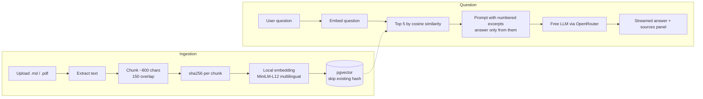

# RAG Next Demo

[](https://github.com/CodeDeivid/rag-next-demo/actions/workflows/ci.yml)
[](https://github.com/CodeDeivid/rag-next-demo/actions/workflows/codeql.yml)
[](LICENSE)

A small retrieval-augmented chat. Upload a few Markdown or text-based PDF files, ask questions, and get a
streamed answer grounded only in those files, with the exact excerpts (file name and similarity score)
shown next to the answer.

Runs at zero cost: embeddings are computed locally with transformers.js, and answers come from a free
OpenRouter model.

**Stack:** Next.js (App Router) · TypeScript · Tailwind · shadcn/ui · Vercel AI SDK (`useChat`,
`streamText`) · PostgreSQL + pgvector · Drizzle · Zod · Vitest.

## How it works



The sources are sent to the browser as a data part before the first token, so the panel fills in while
the answer is still streaming.

## Run it in 5 minutes

Requirements: Node 20+, pnpm, Docker.

```bash
git clone git@github.com:CodeDeivid/rag-next-demo.git && cd rag-next-demo
pnpm install
pnpm bootstrap   # creates .env (asks for a free OpenRouter key), starts Postgres, runs migrations
pnpm dev         # http://localhost:3000
```

`pnpm bootstrap` is safe to run again. Doing it by hand: `cp .env.example .env`, add a key from
https://openrouter.ai/keys, then `pnpm db:up && pnpm db:migrate`.

The first upload downloads the quantized embedding model (~120 MB) into `.cache/models`; after that
embeddings work offline. To switch the answering model, change `OPENROUTER_MODEL` to any id ending in
`:free`.

**Try it:** upload the two fictional handbook pages in [`examples/`](examples) and ask
"How much is the home office allowance and who gets it?" or "Can I expense a business class upgrade?".
Ask something they don't cover ("What is the parental leave policy?") to see the not-found answer.

```bash
pnpm test       # unit tests: chunking, prompt building, citation parsing
pnpm test:e2e   # Playwright + axe accessibility checks
```

## Project layout

```
src/
  app/                    routes: page + /api/documents + /api/chat
  db/                     Drizzle schema and client
  features/rag/core/      pure logic (chunking, prompt), unit tested
  features/rag/server/    embeddings, generation, ingestion, vector search
  features/chat/          UI: documents, chat, sources panels
drizzle/                  SQL migrations
scripts/bootstrap.mjs     one-command local setup
```

Module boundaries and interfaces are in [docs/ARCHITECTURE.md](docs/ARCHITECTURE.md). Embeddings and
generation each sit behind one small function (`embedTexts`, `getChatModel`), so
swapping providers touches one file.

## Quality gates

| Where      | What                                                                                                                                                            |
| ---------- | --------------------------------------------------------------------------------------------------------------------------------------------------------------- |
| pre-commit | ESLint + Prettier on staged files                                                                                                                               |
| commit-msg | Conventional Commits (commitlint)                                                                                                                               |
| pre-push   | typecheck + tests                                                                                                                                               |
| CI         | format, lint, typecheck, unit tests, build, Playwright + axe (WCAG 2.1 AA, light/dark, desktop/mobile), migrations on a real pgvector, commit lint, secret scan |
| Weekly     | CodeQL and Dependabot                                                                                                                                           |

There is no deploy pipeline on purpose: this is a local-first demo, and no deploy tokens live in the
repo. Local embeddings use the native ONNX runtime (~550 MB), which is over the 250 MB limit of
serverless functions such as Vercel's, so a hosted version would need a container host (Fly.io,
Railway, Render) or an embeddings API behind `embedTexts`.

## Decisions

**pgvector instead of a hosted vector database.** The documents, chunks and vectors live in one Postgres,
so ingestion is one transaction (a failed upload leaves nothing half-written), the dedupe rule is a plain `UNIQUE` constraint, and search is one
SQL query with an HNSW index. For a few thousand chunks there is nothing a dedicated vector store would
add, and any managed Postgres with pgvector (Neon, Supabase) works unchanged.

**~800-character chunks with 150 characters of overlap.** Small enough that the top 5 excerpts fit
comfortably in a free model's context and stay on one idea, big enough to keep a full paragraph together.
The overlap keeps a sentence that straddles a boundary retrievable from either side. Splits prefer
paragraph, then line, then sentence, then word boundaries, so Markdown lists stay intact.

**Always show the sources.** The model is told to answer only from numbered excerpts and to say it found
nothing otherwise, but the UI is what makes that checkable: every answer shows the excerpts it was given
and their scores. A user can see at a glance when retrieval was weak, which is the most common way RAG
answers go wrong.

## Known limits

- Free models are rate limited; the UI shows a clear message when that happens.
- Scanned PDFs (images) have no text layer and are rejected.
- Retrieval is pure vector similarity; no keyword search or re-ranking.
- No accounts: documents are shared by everyone using the instance, and uploading a file with an
  existing name replaces it. Run it locally or behind your own access control.
- Uploads are capped at 5 MB and 300 chunks, and questions at 4,000 characters, because embeddings run on
  the server CPU and the model is a free tier.
