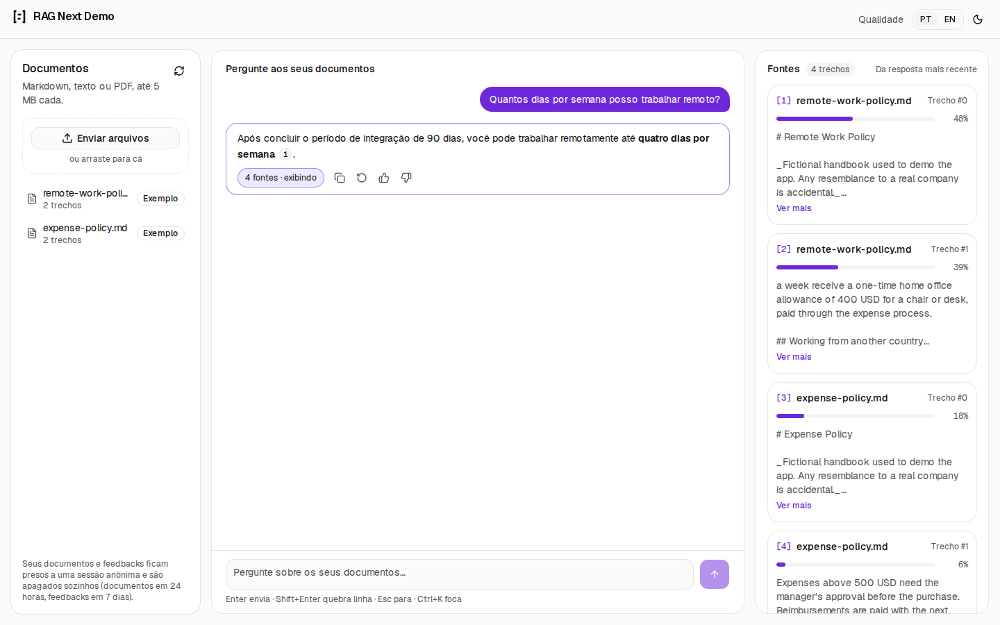
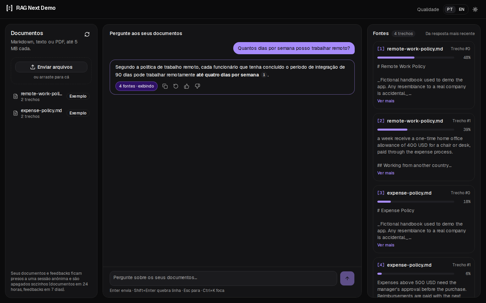
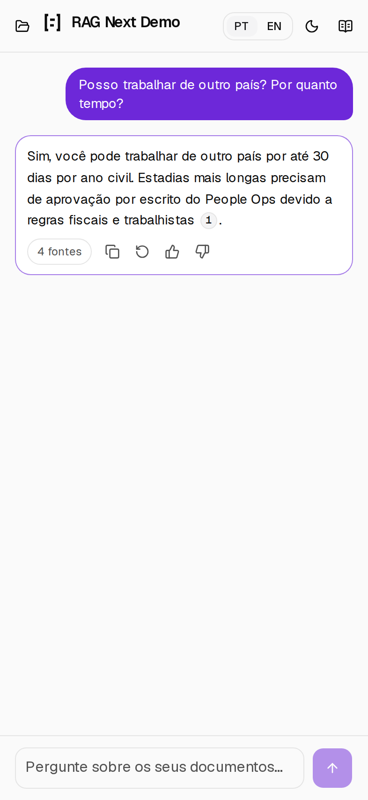
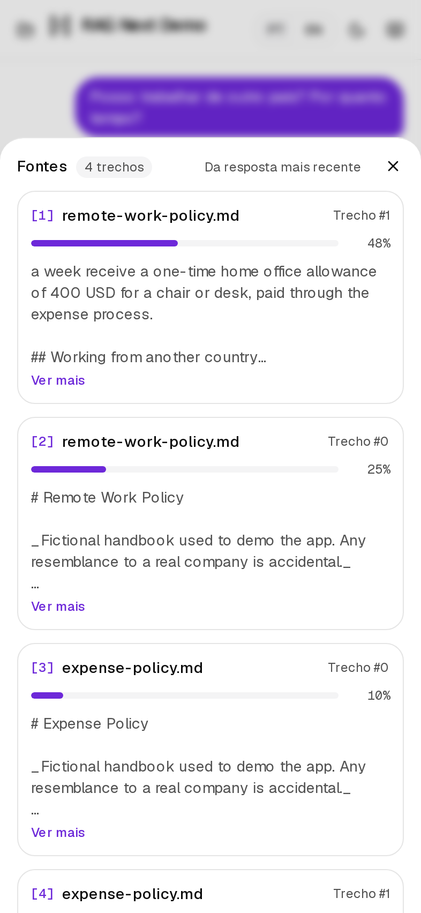
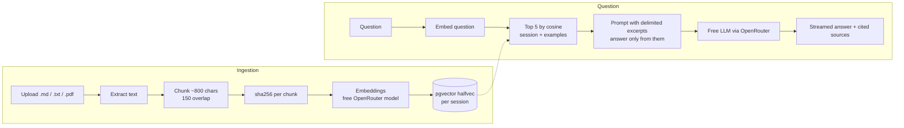

# RAG Next Demo

[](https://github.com/CodeDeivid/rag-next-demo/actions/workflows/ci.yml)
[](https://github.com/CodeDeivid/rag-next-demo/actions/workflows/codeql.yml)
[](LICENSE)

A chat over **your own documents** where every answer shows where it came from. Upload Markdown or
text-based PDFs, ask in Portuguese or English, and get a streamed answer written only from your files,
with numbered citations that highlight the exact excerpt and its similarity score.

|                         Light                         |                        Dark                         |
| :---------------------------------------------------: | :-------------------------------------------------: |
|  |  |

|                   Phone                    |                    Sources sheet                     |
| :----------------------------------------: | :--------------------------------------------------: |
|  |  |

It costs nothing to run: embeddings and answers come from free OpenRouter models, the database is
Postgres with pgvector (Neon's free tier when deployed), and there is no account or card involved.

## What makes it more than a tutorial

- **The AI is transparent.** Sources arrive before the first token, so the panel fills while the answer
  streams. Citations `[1]` `[2]` are buttons: hover or focus one and its source card highlights, with the
  file name, chunk number and a similarity bar. When nothing in the documents supports an answer, the
  interface says so in a distinct card instead of letting the model improvise.
- **The user stays in control.** Stop the answer (button or Esc), regenerate it, copy it, delete documents.
- **Feedback closes the loop.** Thumbs up and down on every answer, with an optional comment on thumbs down.
  The `/quality` page shows the approval rate and the latest negative answers, scoped to your session.
- **Private by construction.** Every visitor gets an anonymous session. Documents, searches and feedback
  are scoped to it on the server; nobody can see or delete anyone else's files. Two shared example
  documents are preloaded and read-only, so the demo works in ten seconds without uploading anything.
- **Two languages.** Portuguese (default) and English, with every string in message files and dates and
  numbers formatted by `Intl`. Documents can be in any language: a Portuguese question is answered from
  an English document because the embedding model is multilingual.
- **Built for phones first.** Below 1024 px the chat fills the screen and documents and sources open as
  sheets; touch targets are at least 44 px and the composer respects the keyboard and safe areas.

## How it works



Uploads stream their progress as NDJSON (received, chunking, embedding n of total, saving, done), so each
file shows a real progress bar instead of a spinner.

**Stack:** Next.js 16 (App Router, Cache Components) · TypeScript · Tailwind 4 · shadcn/ui (Base UI) ·
Vercel AI SDK · next-intl · Motion · PostgreSQL + pgvector · Drizzle · Zod · Vitest · Playwright + axe ·
Storybook.

## Run it in 5 minutes

Requirements: Node 20+, pnpm, Docker.

```bash
git clone git@github.com:CodeDeivid/rag-next-demo.git && cd rag-next-demo
pnpm install
pnpm bootstrap   # creates .env (asks for a free OpenRouter key), starts Postgres, runs migrations
pnpm dev         # http://localhost:3000
```

`pnpm bootstrap` is safe to run again. By hand: `cp .env.example .env`, add a key from
https://openrouter.ai/keys, then `pnpm db:up && pnpm db:migrate`.

To switch the answering model, change `OPENROUTER_MODEL` to any id ending in `:free`. The default,
Nemotron 3 Ultra, was the most faithful of the free models on the grounding, not-found and
prompt-injection cases this demo cares about (Nov 2026); free models change often, and the fallback is
listed in `.env.example`.

```bash
pnpm test        # unit tests: chunking, prompt building, citations, parsing
pnpm test:e2e    # Playwright + axe: a11y, responsive, upload, chat, session isolation
pnpm storybook   # components with their states
```

## Deploy (free, no card)

1. **Database:** create a project at [neon.tech](https://neon.tech) (free). pgvector is available; the first
   migration runs `CREATE EXTENSION vector`.
2. **App:** import the repository in [Vercel](https://vercel.com) (Hobby) and add the Neon integration, which
   sets `DATABASE_URL` and `DATABASE_URL_UNPOOLED`. Add `OPENROUTER_API_KEY`, `OPENROUTER_MODEL` and
   `OPENROUTER_EMBEDDING_MODEL` from `.env.example`.
3. Deploy. `vercel.json` runs the migrations on production builds only, using the direct connection. The
   shared example documents are indexed on the first visit.

Embeddings go through an API (not a local model) precisely so the app fits a serverless function.

## Decisions

**pgvector instead of a hosted vector database.** Documents, chunks, vectors, feedback and rate limits live
in one Postgres: ingestion is one transaction, the dedupe rule is a `UNIQUE` constraint, tenant isolation
is a `WHERE` clause, and search is one SQL query with an HNSW index. For thousands of chunks a dedicated
vector store adds nothing, and Neon gives the same setup for free. Vectors are stored as `halfvec(2048)`
because the HNSW index caps plain vectors at 2,000 dimensions; half precision costs a negligible amount of
retrieval quality.

**~800-character chunks with 150 characters of overlap.** Small enough that the top 5 excerpts fit in a free
model's context and stay on one idea, big enough to keep a paragraph together. The overlap keeps a sentence
that straddles a boundary retrievable from either side. Splits prefer paragraph, then line, then sentence,
then word boundaries. Hard-wrapped lines (PDFs, 80-column files) are joined; Markdown lists and headings are
kept.

**Always show the sources.** The model is told to answer only from numbered excerpts and to say it found
nothing otherwise, but the interface is what makes that checkable: every answer shows the excerpts it was
given and their scores, and the user can see at a glance when retrieval was weak, which is the most common
way RAG answers go wrong.

**Anonymous sessions instead of accounts.** A public demo needs isolation, not login. An `httpOnly` cookie
identifies the visitor; the id is only ever read from the cookie, never from a request body. The trade-off:
clearing cookies loses your uploads, which also expire after 24 hours.

**Embeddings through an API, not in the process.** The first version ran a local transformers.js model, which
is great offline but pulls a ~550 MB native runtime that does not fit a serverless function. Embeddings and
generation each sit behind one small function (`embedTexts`, `getChatModel`), so switching provider touches
one file.

## Accessibility

Targeting WCAG 2.1 AA, checked automatically on every pull request with axe in light and dark, on desktop
and phone, including the error and dialog states.

- Full keyboard use: `Enter` sends, `Shift+Enter` new line, `Esc` stops the answer, `Ctrl/⌘+K` focuses the
  question box, and a skip link is the first tab stop.
- Focus is managed on delete (back to a stable control) and when sheets open and close.
- Streaming is announced by status changes ("Searching your documents", "Writing the answer"), never token
  by token.
- Citation chips, icon buttons and the language switcher have accessible names that match what is visible.
- `prefers-reduced-motion` removes all movement; colour pairs are at least 4.5:1 in both themes.
- Touch targets are at least 44 px on touch screens.

Lighthouse on the production build: accessibility 100, best practices 96, performance 99 on desktop and
92 on a throttled phone, with no layout shift. The markdown renderer and the animation features load only
when needed, which cut the first load from 568 to 370 KiB.

## Security model

| Risk                                       | Protection                                                                               |
| ------------------------------------------ | ---------------------------------------------------------------------------------------- |
| Reading or deleting another visitor's data | Session id from an `httpOnly` cookie; every query filters by it; covered by an e2e test  |
| Spending the free quota                    | Rate limits per session and per IP in Postgres; size, chunk and message caps             |
| Server-side request forgery                | Only text parts reach the model; client-sent file or URL parts are dropped               |
| Prompt injection from a document           | Excerpts are delimited and escaped; the model is told to ignore instructions inside them |
| Cross-site scripting                       | Markdown renders without raw HTML or images; strict CSP and security headers             |
| Leaked secrets                             | Keys live in environment variables only; gitleaks runs in CI                             |

Report vulnerabilities as described in [SECURITY.md](SECURITY.md).

## Project layout

```
src/
  app/[locale]/           pages (chat, /quality), link preview image
  app/api/                documents (NDJSON upload), chat (stream), feedback
  db/                     Drizzle schema and client
  features/rag/core/      pure logic (chunking, prompt), unit tested
  features/rag/server/    embeddings, generation, ingestion, search, rate limits
  features/chat|documents|feedback|session|locale|theme|brand/   UI and server code per feature
  i18n/ + messages/       routing and translations (pt, en)
drizzle/                  SQL migrations
e2e/                      Playwright specs (a11y, responsive, upload, chat, isolation)
```

Module boundaries are described in [docs/ARCHITECTURE.md](docs/ARCHITECTURE.md).

## Quality gates

| Where      | What                                                                                                                  |
| ---------- | --------------------------------------------------------------------------------------------------------------------- |
| pre-commit | ESLint and Prettier on staged files                                                                                   |
| commit-msg | Conventional Commits (commitlint)                                                                                     |
| pre-push   | typecheck and unit tests                                                                                              |
| CI         | format, lint, typecheck, unit tests, build, Playwright + axe, migrations on a real pgvector, commit lint, secret scan |
| Weekly     | CodeQL (public repo) and Dependabot                                                                                   |

## Known limits

- Free models are rate limited; the interface shows a clear message when that happens.
- Scanned PDFs (images) have no text layer and are rejected.
- Retrieval is pure vector similarity: no keyword search or re-ranking yet.
- Uploads are capped at 5 MB and 300 chunks, questions at 4,000 characters, because embedding calls hit a
  free API.
- Clearing cookies or switching browsers starts a new session; uploads expire after 24 hours.

## What I would do next

A small evaluation set (questions with the expected excerpt) to measure retrieval hit rate while changing
chunk size, then hybrid search (vector plus full-text) and a re-ranking step.

## License

MIT
